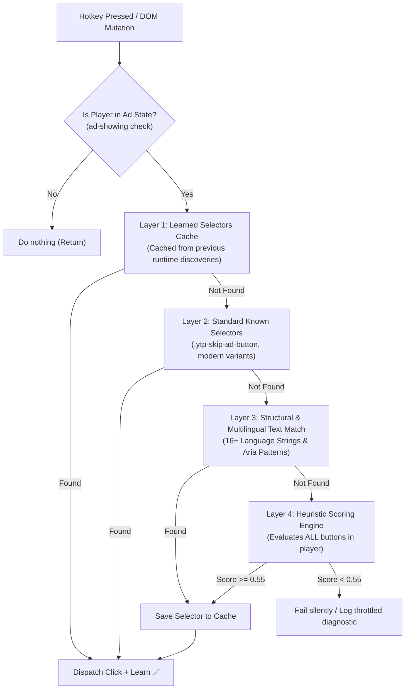

<p align="center">
  
</p>

<h1 align="center">Ski Extension</h1>

<p align="center">
  <strong>Fast, private, keyboard-only browser extension that clicks YouTube's own Skip Ad button the millisecond it appears.</strong>
</p>

<p align="center">
  <a href="https://github.com/WinterJackson/ski/actions/workflows/ci.yml"></a>
  <a href="https://github.com/WinterJackson/ski/blob/main/LICENSE"></a>
  
  
  
  
</p>

<p align="center">
  <a href="#-key-features">Key Features</a> •
  <a href="#-how-self-healing-works">Adaptive Self-Healing</a> •
  <a href="#-installation">Installation</a> •
  <a href="#-usage--options">Usage & Options</a> •
  <a href="#-architecture">Architecture</a> •
  <a href="#-security--privacy">Privacy</a> •
  <a href="#-development">Development</a>
</p>

---

## ⚡ Why Ski Extension?

Most tools that deal with ads use invasive tactics: injecting network filters, muting players, fast-forwarding video tracks to 16x, or running heavy background processes. These tricks routinely break, trigger anti-adblock countermeasures, and compromise browser performance.

**Ski Extension takes an honest, lightweight approach:**
1. It listens for your hotkey in the capture phase.
2. It detects YouTube's official **Skip Ad** button inside the video player.
3. It dispatches a trusted click event directly to the button.
4. **Nothing else changes.** Your player stays standard, stable, and compliant.

> [!TIP]
> **Zero telemetry, zero external network calls.** The entire unpacked script weighs under **15 KB** with zero runtime dependencies.

---

## ✨ Key Features

- ⌨️ **Single Hotkey Skip**: Tap your configured key (default: `.`) to instantly trigger YouTube's Skip button without moving the mouse.
- 🛡️ **Typing-Context Guard**: Smart inspection ignores keypresses while you're typing in YouTube comments, search bars, textareas, inputs, or `contenteditable` tags.
- 🧠 **Adaptive Self-Healing Engine**: Uses a 4-layer fallback pipeline with weighted heuristic scoring. If YouTube obfuscates or renames class names, Ski Extension identifies the button by position, DOM context, and metadata, then **learns and caches** the new selector automatically.
- 🌐 **Multi-Language Detection**: Pre-configured with localized "Skip" variants across 16+ languages (English, German, French, Spanish, Japanese, Chinese, Arabic, Hindi, etc.).
- 🔄 **SPA Navigation Resilient**: Hooks into `yt-navigate-finish` to keep hotkey listeners and observers intact during long uninterrupted viewing sessions.
- 🎛️ **Modern Options Hub**: Dark-themed options panel equipped with an interactive live hotkey recorder, modifier key combinations (Ctrl/Alt/Shift/Cmd), and YouTube shortcut conflict warnings.
- 🔔 **Subtle Shadow DOM Toast**: Optional non-intrusive on-screen notification confirming skips without interfering with YouTube's stylesheet.
- 🤖 **Optional Auto-Skip**: Opt-in background observer mode to automatically click the Skip button as soon as the countdown completes.

---

## 🧠 How Self-Healing Works

YouTube regularly rolls out A/B tests and updates that rename player classes (`.ytp-skip-ad-button` ➔ `.ytp-ad-skip-button-modern` ➔ dynamic hash classes). Ski Extension prevents breakage through an intelligent, multi-stage detection engine:



### Heuristic Scoring Metric

When known classes fail, the engine inspects all candidate buttons in the player tree across 6 weighted signals:

| Signal | Weight | Logic |
| :--- | :---: | :--- |
| **Class Hint** | `25%` | Checks class ancestry for `skip` or `ad` substrings |
| **Spatial Position** | `20%` | Verifies bottom-right quadrant positioning in player bounds |
| **Ad Ancestry** | `20%` | Inspects parent tree for ad overlay containers and module slots |
| **Action Text Length** | `15%` | Favors compact, concise text labels ($\le 20$ chars) |
| **Fuzzy Semantic Match** | `10%` | Regex matching against global translations and skip stems |
| **Aria / Title Attributes** | `10%` | Evaluates accessibility descriptors |

---

## 📦 Installation

### Load Unpacked (Chrome / Brave / Edge / Chromium)
1. Clone the repository:
   ```bash
   git clone https://github.com/WinterJackson/ski.git
   cd ski/ski
   ```
2. Build the production bundle:
   ```bash
   pnpm install
   pnpm build
   ```
3. Open `chrome://extensions` in your browser.
4. Enable **Developer mode** (toggle in top-right corner).
5. Click **Load unpacked** and select the `.output/chrome-mv3` directory.

### Temporary Add-on (Firefox)
1. Build the Firefox bundle:
   ```bash
   pnpm build:firefox
   ```
2. Navigate to `about:debugging#/runtime/this-firefox`.
3. Click **Load Temporary Add-on...** and select any file inside `.output/firefox-mv2/` (e.g., `manifest.json`).

---

## 🎮 Usage & Options

1. Open any YouTube video with an ad.
2. As soon as the countdown finishes and the **Skip Ad** button appears, press your hotkey (default: **`.`**).
3. The ad skips immediately.

### Customizing Your Hotkey
- Right-click the Ski Extension icon in your browser toolbar and choose **Options** (or open the extensions page).
- Click **Change** in the Hotkey recorder and press your desired key or combination (e.g., `Shift + S`, `X`, `Ctrl + .`).
- The recorder will alert you if your chosen key clashes with YouTube default shortcuts (like `K` for pause, `J`/`L` for seek, or `F` for fullscreen).

---

## 🏗️ Architecture

```
ski/
├── entrypoints/
│   ├── content.ts              # Content script entry point (DOM capture listener)
│   └── options/                # Options interface (HTML + TypeScript + CSS)
│       ├── index.html
│       ├── main.ts
│       └── style.css
├── src/
│   ├── content/
│   │   ├── selectors.ts        # Known class patterns & multi-language lookup
│   │   ├── detector.ts         # 4-layer self-healing detection & click pipeline
│   │   ├── hotkey.ts           # Keyboard event evaluator & typing guard
│   │   ├── observer.ts         # SPA route listener & auto-skip mutation observer
│   │   └── toast.ts            # Non-intrusive shadow DOM confirmation toast
│   └── shared/
│       ├── settings.ts         # Typed schema, sync storage manager, validators
│       └── keycombo.ts         # Hotkey serializer, parser, & code mapper
├── tests/
│   ├── fixtures/
│   │   └── player-states.ts    # Captured real YouTube DOM fixtures
│   └── unit/                   # 43 automated unit & fixture tests
├── public/icon/                # Extension branding icons (16, 32, 48, 96, 128px)
├── wxt.config.ts               # WXT cross-browser framework configuration
└── package.json
```

---

## 🔒 Security & Privacy

Ski Extension follows strict privacy-first guidelines:

- **No Remote Code**: Complies with Chrome MV3 security policies. All logic ships within the verified build package.
- **Minimal Permissions**: Demands only `storage` for user settings and host permissions for `*://www.youtube.com/*` & `*://www.youtube-nocookie.com/*`.
- **Zero Analytics or Tracking**: No Google Analytics, no telemetry, no cookies, no Sentry, and no phone-home servers.
- **Audit-Ready**: 100% open source under the MIT License. Read [PRIVACY.md](PRIVACY.md) for full disclosure.

---

## 💻 Development

### Prerequisites
- Node.js `v20+` or `v22+`
- `pnpm` (recommended)

### Commands

| Command | Description |
| :--- | :--- |
| `pnpm dev` | Starts dev server with live hot-reloading in Chrome |
| `pnpm dev:firefox` | Starts dev server targeting Firefox |
| `pnpm test` | Runs complete Vitest test suite (43+ unit & fixture tests) |
| `pnpm test:watch` | Runs Vitest in interactive watch mode |
| `pnpm compile` | Runs TypeScript type checker (`tsc --noEmit`) |
| `pnpm build` | Compiles optimized Chrome MV3 bundle into `.output/chrome-mv3` |
| `pnpm build:firefox` | Compiles Firefox MV2 bundle into `.output/firefox-mv2` |
| `pnpm zip` | Packages production distribution archive for Chrome Web Store |
| `pnpm zip:firefox` | Packages distribution zip + source zip for Firefox AMO |

---

## 🤝 Contributing & Bug Reports

When YouTube pushes an interface update that evades detection, help us patch it in minutes:

1. Open an issue using our [Hotkey Stopped Working](https://github.com/WinterJackson/ski/issues/new?template=hotkey-stopped-working.yml) template.
2. Include your browser version and YouTube UI language.
3. PRs adding new language translations or fixtures are warmly welcomed!

---

## 📄 License

Licensed under the [MIT License](LICENSE).  
Crafted with precision by **[Winter Jackson](https://github.com/WinterJackson)** — Available for software engineering & freelance projects.
