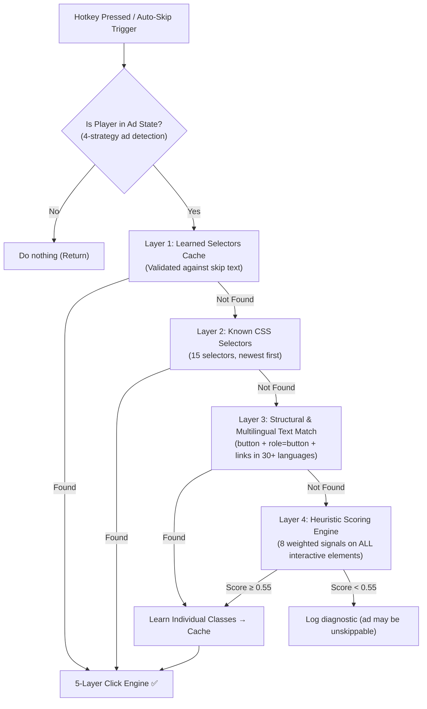

<p align="center">
  
</p>

<h1 align="center">Ski Extension</h1>

<p align="center">
  <strong>Fast, private, keyboard-only browser extension that clicks YouTube's own Skip Ad button the millisecond it appears.</strong>
</p>

<p align="center">
  <a href="https://github.com/WinterJackson/ski/actions/workflows/ci.yml"></a>
  <a href="https://github.com/WinterJackson/ski/blob/main/LICENSE"></a>
  
  
  
  
</p>

<p align="center">
  <a href="#-key-features">Key Features</a> •
  <a href="#-how-self-healing-works">Adaptive Self-Healing</a> •
  <a href="#-stats-dashboard">Stats Dashboard</a> •
  <a href="#-installation">Installation</a> •
  <a href="#-usage--options">Usage & Options</a> •
  <a href="#-architecture">Architecture</a> •
  <a href="#-security--privacy">Privacy</a> •
  <a href="#-development">Development</a>
</p>

---

## ⚡ Why Ski Extension?

Most tools that deal with ads use invasive tactics: injecting network filters, muting players, fast-forwarding video tracks to 16x, or running heavy background processes. These tricks routinely break, trigger anti-adblock countermeasures, and compromise browser performance.

**Ski Extension takes an honest, lightweight approach:**
1. It listens for your hotkey in the capture phase.
2. It detects YouTube's official **Skip Ad** button inside the video player.
3. It dispatches a trusted click event directly to the button.
4. **Nothing else changes.** Your player stays standard, stable, and compliant.

> [!TIP]
> **Zero telemetry, zero external network calls.** The entire unpacked content script weighs under **17 KB** with zero runtime dependencies.

---

## ✨ Key Features

### Core Skip Engine
- ⌨️ **Single Hotkey Skip** — Tap your configured key (default: `Tab`) to instantly trigger YouTube's Skip button without moving the mouse.
- 🤖 **Optional Auto-Skip** — Opt-in background observer mode that automatically clicks the Skip button the moment the countdown ends — no keypress needed.
- 🔁 **Consecutive Ad Handling** — Automatically handles back-to-back ads (Ad 1 of 2 → Ad 2 of 2). A single keypress skips Ad 1 and then auto-detects and skips Ad 2 within seconds. Works in both manual and auto-skip modes.
- 🔄 **Configurable Hotkey** — Change to any key or key combination (e.g., `Shift+S`, `X`, `Ctrl+.`) from the options page. Changes apply instantly across all YouTube tabs — no reload needed.

### Self-Healing Detection
- 🧠 **4-Layer Adaptive Detection Engine** — Uses learned selectors, known CSS selectors, multilingual text matching, and weighted heuristic scoring. If YouTube obfuscates or renames class names, Ski Extension identifies the button by text content, element type, position, and DOM context, then **learns and caches** the new selector automatically.
- 🌐 **30+ Language Detection** — Pre-configured with localized "Skip" strings across 30+ languages: English, German, French, Spanish, Portuguese, Italian, Dutch, Swedish, Finnish, Norwegian, Danish, Polish, Czech, Romanian, Hungarian, Greek, Russian, Ukrainian, Turkish, Arabic, Hebrew, Hindi, Thai, Vietnamese, Indonesian, Malay, Japanese, Korean, Chinese (Simplified & Traditional), Bengali, Tamil, and Swahili.
- 🛡️ **4-Strategy Ad Detection** — Detects ads via known class names, broader player selectors, visible ad overlay containers, and regex pattern matching on player classes. Survives YouTube renaming the `ad-showing` class.
- 🔁 **5-Layer Click Engine** — Direct button click → ancestor container click → shotgun all skip elements → main-world API dispatch → video seek fallback. Retries automatically until the ad is gone.

### Smart UI & UX
- 🛡️ **Typing-Context Guard** — Smart inspection ignores keypresses while you're typing in YouTube comments, search bars, textareas, inputs, or `contenteditable` elements. Also ignores IME composition.
- 🔄 **SPA Navigation Resilient** — Hooks into `yt-navigate-finish` to keep hotkey listeners and observers intact during long uninterrupted viewing sessions. Auto-skip re-attaches automatically with retry logic.
- 🎛️ **Modern Options Hub** — Dark-themed options panel with an interactive live hotkey recorder, modifier key combinations (Ctrl/Alt/Shift/Cmd), and YouTube shortcut conflict warnings.
- 🔔 **Subtle Shadow DOM Toast** — Optional non-intrusive on-screen notification confirming skips. Rendered inside a shadow root to avoid YouTube CSS conflicts. Waits until the ad is actually gone before showing.

### Stats & Activity
- 📊 **Stats Dashboard** — Track total ads skipped, estimated time saved, today/this week counters, and auto vs manual breakdown with a visual ratio bar.
- 📋 **Activity Log (Opt-in)** — Optionally record which videos had ads when you skipped, with timestamps and skip method. Data stays on your device — never sent anywhere. Clear history with one click.
- ⏱️ **Time Saved Estimate** — See how much time you've saved (~15s per skipped ad), formatted as hours and minutes.

---

## 🧠 How Self-Healing Works

YouTube regularly rolls out A/B tests and updates that rename player classes (`.ytp-skip-ad-button` ➔ `.ytp-ad-skip-button-modern` ➔ dynamic hash classes). Ski Extension prevents breakage through an intelligent, multi-stage detection engine:



### Heuristic Scoring Signals

When known classes fail, the engine inspects all candidate interactive elements (`<button>`, `[role="button"]`, `<a>`, `[tabindex]`) in the player and scores them across 8 weighted signals:

| Signal | Weight | Logic |
| :--- | :---: | :--- |
| **Skip Text Match** | `30%` | Exact or fuzzy match against 30+ language translations of "Skip" — the dominant signal |
| **Spatial Position** | `15%` | Verifies bottom-right quadrant positioning in player bounds |
| **Ad Ancestry** | `13%` | Inspects parent tree (8 levels) for ad overlay containers and module slots |
| **Class Hint** | `12%` | Checks class ancestry for `skip` or `ad` substrings |
| **Element Type** | `10%` | `<button>` and `role="button"` score higher than `<a>` or generic elements |
| **Text Length** | `10%` | Favors compact, action-like text labels (≤ 20 chars) |
| **Aria / Title Label** | `5%` | Bonus for having an accessibility descriptor |
| **Element Size** | `5%` | Skip buttons have a reasonable clickable area (1,000–20,000 px²) |

> [!IMPORTANT]
> **Nuclear obfuscation test:** Even with ALL class names fully randomized, no aria-label, and no recognizable patterns anywhere in the DOM hierarchy, the heuristic scores **0.69** (above the 0.55 threshold) — finding the skip button purely by text content and element type.

### Selector Learning

When the heuristic or text match discovers a skip button, the extension **learns individual distinctive classes** (not the full class list) and persists them to `chrome.storage.local`. This means:
- If YouTube adds or removes one class on the skip button, the other learned classes still match.
- Learned selectors are tried first on subsequent pages (Layer 1), making detection near-instant.
- Up to 10 selectors are cached, oldest pruned first.

---

## 📊 Stats Dashboard

The options page includes a rich stats dashboard that updates in real time:

| Metric | Description |
| :--- | :--- |
| **Ads Skipped** | Total lifetime count of successfully skipped ads |
| **Time Saved** | Estimated time saved (~15 seconds per ad), formatted as hours and minutes |
| **Today / This Week** | Rolling counters for daily and 7-day skip activity |
| **Manual vs Auto** | Breakdown of hotkey-triggered vs auto-skip-triggered skips, with visual ratio bar |
| **Activity Log** | Opt-in recent history showing video title, skip method, and time ago (last 50 entries) |

> [!NOTE]
> The Activity Log is **off by default**. Enable "Track recent activity" in options to start recording. All data stays on your device and can be cleared with one click.

---

## 📦 Installation

### Load Unpacked (Chrome / Brave / Edge / Chromium)
1. Clone the repository:
   ```bash
   git clone https://github.com/WinterJackson/ski.git
   cd ski/ski
   ```
2. Build the production bundle:
   ```bash
   pnpm install
   pnpm build
   ```
3. Open `chrome://extensions` in your browser.
4. Enable **Developer mode** (toggle in top-right corner).
5. Click **Load unpacked** and select the `.output/chrome-mv3` directory.

### Temporary Add-on (Firefox)
1. Build the Firefox bundle:
   ```bash
   pnpm build:firefox
   ```
2. Navigate to `about:debugging#/runtime/this-firefox`.
3. Click **Load Temporary Add-on...** and select any file inside `.output/firefox-mv2/` (e.g., `manifest.json`).

### 📱 Android (Firefox / Kiwi Browser)

Ski Extension works on Android through browsers that support extensions:

- **Firefox for Android** — Install from [Firefox Add-ons (AMO)](https://addons.mozilla.org/firefox/addon/ski-extension/). Auto-skip is enabled by default on touch devices since there's no keyboard.
- **Kiwi Browser** — A Chromium-based Android browser with extension support. Load the Chrome MV3 build as an unpacked extension just like on desktop.

> [!NOTE]
> **On touch devices**, Ski Extension automatically detects that no keyboard is present and enables auto-skip by default. If you connect a Bluetooth keyboard, the hotkey works alongside auto-skip — no mode switching needed.

---

## 🎮 Usage & Options

1. Open any YouTube video with an ad.
2. As soon as the countdown finishes and the **Skip Ad** button appears, press your hotkey (default: **`Tab`**).
3. The ad skips immediately.

### Customizing Your Hotkey
- Right-click the Ski Extension icon in your browser toolbar and choose **Options** (or open the extensions page).
- Click **Change** in the Hotkey recorder and press your desired key or combination (e.g., `Shift + S`, `X`, `Ctrl + .`).
- The recorder will alert you if your chosen key clashes with YouTube default shortcuts (like `K` for pause, `J`/`L` for seek, or `F` for fullscreen).
- Changes take effect immediately — no page reload needed.
- Click **Reset to default** to restore the `Tab` key.

### Auto-Skip Mode
- Toggle **Auto-skip ads** in the options page to enable automatic skipping.
- **On touch devices (phones/tablets)**, auto-skip is enabled by default on first run — detected via `navigator.maxTouchPoints`.
- When enabled, Ski Extension watches for ads via a MutationObserver on the player's class attribute (efficient — no subtree watching).
- When an ad is detected, it polls for the skip button every 300ms and clicks it the moment it becomes available.
- **Consecutive ads** (Ad 1 of 2 → Ad 2 of 2) are handled automatically: after clicking Ad 1's skip button, polling continues with a brief cooldown, then catches and skips Ad 2.
- Stops polling after 30 seconds for unskippable ads to avoid unnecessary CPU usage.
- The hotkey and auto-skip work **simultaneously** — if a keyboard is connected to a tablet, both are active.

### Activity Log
- Toggle **Track recent activity** in the options page.
- When enabled, records the video title, skip method (manual/auto), and timestamp for each skip.
- Data is stored locally on your device — never transmitted anywhere.
- Shows up to 20 recent entries with relative timestamps ("3h ago", "yesterday").
- Use **Clear history** to wipe all activity data.

---

## 🏗️ Architecture

```
ski/
├── entrypoints/
│   ├── content.ts              # Content script entry point (DOM capture listener)
│   └── options/                # Options interface (HTML + TypeScript + CSS)
│       ├── index.html          # Stats dashboard, hotkey recorder, toggles
│       ├── main.ts             # Settings persistence, stats rendering, activity log
│       └── style.css           # Dark theme with stat cards, breakdown bars
├── src/
│   ├── content/
│   │   ├── selectors.ts        # 15 CSS selectors, 30+ language strings, aria patterns
│   │   ├── detector.ts         # 4-layer detection, 8-signal heuristic, 5-layer click engine
│   │   ├── hotkey.ts           # Keyboard event evaluator & typing guard
│   │   ├── observer.ts         # SPA route listener & auto-skip mutation observer
│   │   └── toast.ts            # Non-intrusive shadow DOM confirmation toast
│   └── shared/
│       ├── settings.ts         # Settings schema, stats tracking, validators, formatters
│       └── keycombo.ts         # Hotkey serializer, parser, & code mapper
├── public/
│   ├── ski-main.js             # Main-world helper (YouTube API access, multilingual text match)
│   └── icon/                   # Extension branding icons (16, 32, 48, 96, 128px)
├── tests/
│   ├── fixtures/
│   │   └── player-states.ts    # 12 DOM fixtures including nuclear obfuscation tests
│   └── unit/                   # 75 automated unit & fixture tests
├── wxt.config.ts               # WXT cross-browser framework configuration
├── vitest.config.ts            # Test runner configuration
└── package.json
```

### Module Responsibilities

| Module | Lines | Responsibility |
| :--- | :---: | :--- |
| `detector.ts` | ~690 | Core detection engine: `isAdShowing()`, `findSkipButton()`, `discoverSkipButton()`, `clickSkipButton()` with consecutive-ad grace period, selector learning, heuristic scoring |
| `selectors.ts` | ~177 | All CSS selectors, 30+ language skip strings, aria-label patterns, ad container selectors |
| `observer.ts` | ~200 | Auto-skip MutationObserver (class-attribute only), SPA navigation hooks, polling loop with consecutive-ad cooldown |
| `settings.ts` | ~290 | Settings & stats types, `recordSkip()`, `loadStats()`, formatters, validators |
| `content.ts` | ~160 | Wiring: loads settings, attaches keydown handler, manages auto-skip lifecycle, consecutive-ad watcher, video title capture |
| `ski-main.js` | ~90 | Main-world helper: clicks buttons from YouTube's JS context, multilingual fallback, YouTube API, video seek |

---

## 🔒 Security & Privacy

Ski Extension follows strict privacy-first guidelines:

- **No Remote Code**: Complies with Chrome MV3 security policies. All logic ships within the verified build package.
- **Minimal Permissions**: Demands only `storage` for user settings and host permissions for `youtube.com`, `m.youtube.com`, and `youtube-nocookie.com`.
- **Zero Analytics or Tracking**: No Google Analytics, no telemetry, no cookies, no Sentry, and no phone-home servers.
- **Local-Only Stats**: Skip counts and activity logs are stored exclusively in `chrome.storage.local` on your device. Never transmitted.
- **Opt-In Activity Log**: Video title recording is off by default. When enabled, data stays local and can be cleared with one click.
- **Audit-Ready**: 100% open source under the MIT License. Read [PRIVACY.md](PRIVACY.md) for full disclosure.

---

## 📱 Platform Support

| Platform | Status | Notes |
| :--- | :---: | :--- |
| Chrome / Brave / Edge / Opera (Desktop) | ✅ | Chrome MV3 build |
| Firefox (Desktop) | ✅ | Firefox MV2 build |
| Firefox for Android | ✅ | Auto-skip default ON, responsive UI |
| Kiwi Browser (Android) | ✅ | Chrome MV3 build works as-is |
| Embedded YouTube (`youtube-nocookie.com`) | ✅ | `allFrames: true` covers iframes |
| YouTube Mobile App (Android/iOS) | ❌ | Native app — no extension API available |
| Chrome on Android/iOS | ❌ | Google does not support extensions on mobile Chrome |
| Smart TVs / Game Consoles | ❌ | Native YouTube app only |

---

## 💻 Development

### Prerequisites
- Node.js `v20+` or `v22+`
- `pnpm` (recommended)

### Commands

| Command | Description |
| :--- | :--- |
| `pnpm dev` | Starts dev server with live hot-reloading in Chrome |
| `pnpm dev:firefox` | Starts dev server targeting Firefox |
| `pnpm test` | Runs complete Vitest test suite (75 unit & fixture tests) |
| `pnpm test:watch` | Runs Vitest in interactive watch mode |
| `pnpm test:coverage` | Runs tests with V8 code coverage report |
| `pnpm compile` | Runs TypeScript type checker (`tsc --noEmit`) |
| `pnpm build` | Compiles optimized Chrome MV3 bundle into `.output/chrome-mv3` |
| `pnpm build:firefox` | Compiles Firefox MV2 bundle into `.output/firefox-mv2` |
| `pnpm zip` | Packages production distribution archive for Chrome Web Store |
| `pnpm zip:firefox` | Packages distribution zip + source zip for Firefox AMO |

### Test Coverage

| Test File | Tests | Coverage |
| :--- | :---: | :--- |
| `detector.test.ts` | 34 | Detection layers, heuristic scoring, nuclear obfuscation, multilingual, role=button, click engine |
| `settings.test.ts` | 17 | Validation, conflict detection, time formatting, daily/weekly counters |
| `keycombo.test.ts` | 14 | Serialization, parsing, formatting, round-trips, modifier matching |
| `hotkey.test.ts` | 10 | Key matching, typing guard, repeat suppression, modifier combos |
| **Total** | **75** | |

---

## 🤝 Contributing & Bug Reports

When YouTube pushes an interface update that evades detection, help us patch it in minutes:

1. Open an issue using our [Hotkey Stopped Working](https://github.com/WinterJackson/ski/issues/new?template=hotkey-stopped-working.yml) template.
2. Include your browser version and YouTube UI language.
3. PRs adding new language translations or fixtures are warmly welcomed!

---

## 📄 License

Licensed under the [MIT License](LICENSE).  
Crafted with precision by **[Winter Jackson](https://github.com/WinterJackson)** — Available for software engineering & freelance projects.
